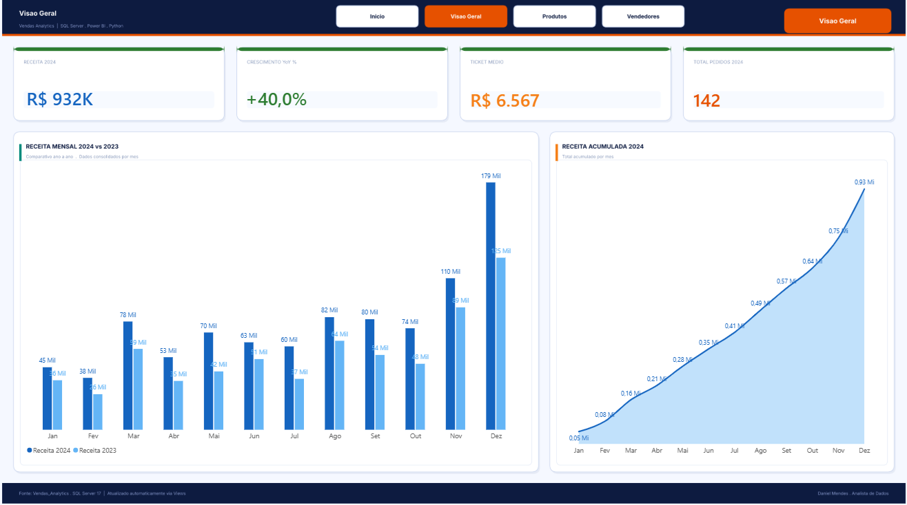
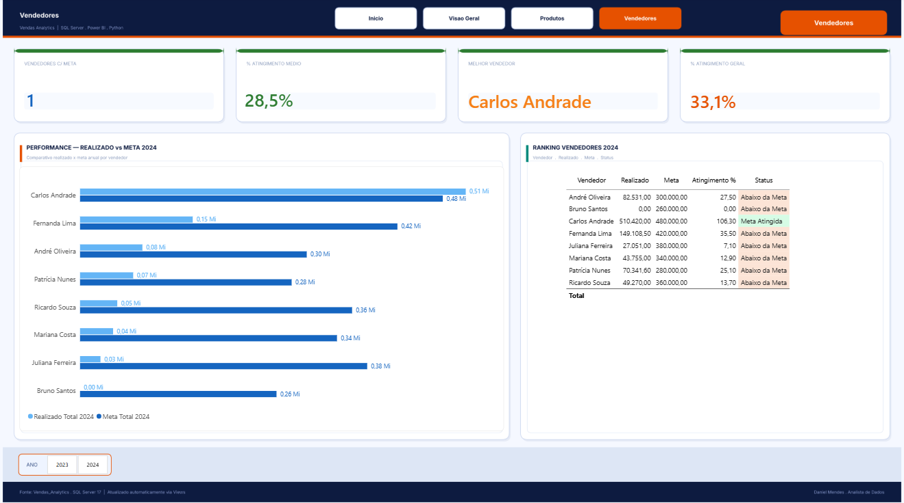
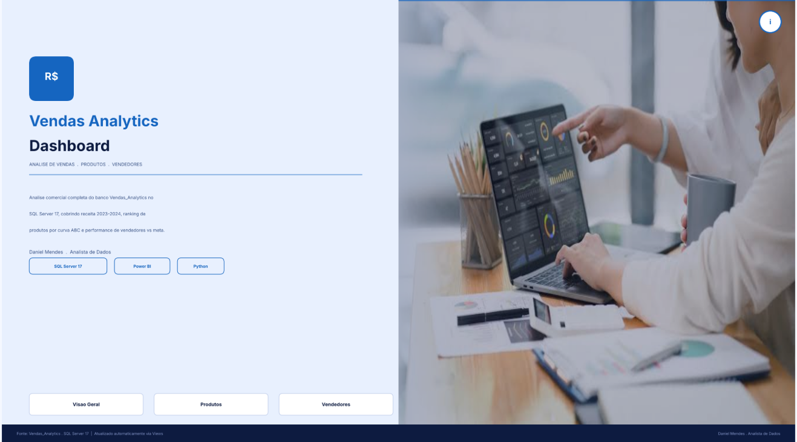
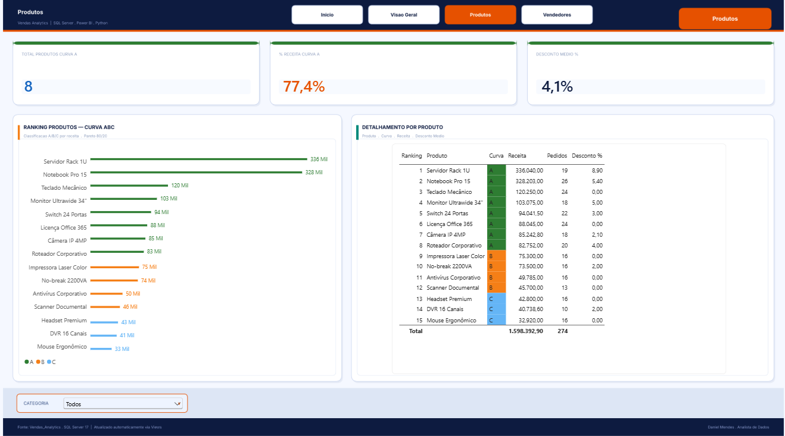

# 🛒 Vendas Analytics — Crescimento real, mas concentrado

> Análise comercial de ponta a ponta: SQL Server → Power BI → Python


---

## 📌 Resumo Executivo

**Pergunta de negócio:** a receita cresceu 40%. Esse crescimento é sustentável?

**Resposta:** o crescimento é real, mas frágil: depende de poucos vendedores, clientes e produtos, e as metas não refletem essa realidade.

| # | Achado | Evidência |
|---|--------|-----------|
| 1 | **O crescimento é real** | +40% de receita (R$ 666 mil → R$ 932 mil) · +21% em unidades, com mais volume em todos os 15 produtos |
| 2 | **A receita é concentrada** | 1 vendedor gera 55% · 3 clientes geram 61% · 2 produtos geram 42% (2024) |
| 3 | **Os riscos se sobrepõem** | O maior cliente (Prefeitura de Recife, 24% da receita) compra o produto nº 1 com o maior vendedor, de São Paulo, enquanto o vendedor de Recife não tem nenhuma venda em dois anos |
| 4 | **As metas estão descalibradas** | Metas somam R$ 2,82 Mi, 3,0× a receita · só 1 de 8 vendedores bateu a meta |

**Recomendação:** diversificar a carteira de clientes, redistribuir contas por território e recalibrar as metas pela carteira real de cada vendedor.

### 📽️ Apresentação

| Arquivo | Para quê |
|---------|----------|
| [📄 Vendas_Analytics_Apresentacao.pdf](apresentacao/Vendas_Analytics_Apresentacao.pdf) | Leitura rápida: 11 slides de negócio + 5 de apêndice técnico |
| [📊 Vendas_Analytics_Apresentacao.pptx](apresentacao/Vendas_Analytics_Apresentacao.pptx) | Versão editável, com notas do apresentador |

---

## 📊 Dashboard Power BI

### Visão Geral
Receita 2024, crescimento, ticket médio e pedidos, com a receita mensal comparada e a receita acumulada do ano.



### Vendedores
Meta × realizado por vendedor, atingimento médio e geral, e ranking de 2024 com todos os vendedores (inclusive quem não vendeu).



<details>
<summary><b>Ver as outras páginas (Início e Produtos)</b></summary>

### Início


### Produtos
Ranking de produtos com curva ABC (80/95), participação na receita e desconto efetivo.



</details>

---

## 🏗️ Arquitetura

```
SQL Server (esquema estrela + 7 views)  →  Power BI (4 páginas + medidas DAX)  →  Python (6 gráficos)  →  GitHub
```

As regras de negócio ficam nas views: ticket médio, curva ABC, desconto e concentração são calculados uma vez e lidos igual pelo Power BI e pelo Python.

### 🗄️ Modelagem de Dados (SQL Server)

**Esquema estrela:**
- `fato_vendas`: 274 vendas (2023–2024), com receita bruta e líquida como colunas calculadas `PERSISTED`
- `dim_produtos`, `dim_clientes`, `dim_vendedores`, `dim_regioes`

**Views (camada de consumo):**

| View | O que entrega | Consumida por |
|------|---------------|---------------|
| `vw_vendas_mensal_yoy` | Receita, ticket médio e receita acumulada por mês, com comparação ano a ano | Power BI · Python |
| `vw_ranking_produtos_abc` | Ranking de produtos, curva ABC (80/95) e desconto efetivo | Power BI · Python |
| `vw_performance_vendedores` | Meta × realizado de todos os vendedores em todos os anos | Power BI · Python |
| `vw_vendas_categoria_acumulado` | Receita acumulada por categoria | Consultas analíticas |
| `vw_analise_clientes` | Receita e recência por cliente | Power BI |
| `vw_kpis_anuais` | KPIs anuais e crescimento | Power BI |
| `vw_concentracao_receita` | Participação e participação acumulada por vendedor, cliente e produto | Python |

**Destaques de SQL:** CTEs, `CROSS JOIN` + `LEFT JOIN` para incluir vendedores sem vendas, window functions (`RANK`, `LAG`, `SUM OVER` com acumulado) e `UNION ALL` para a análise de concentração. Script em [`sql/Vendas analytics projeto.sql`](sql/Vendas%20analytics%20projeto.sql).

---

## 🐍 Análise Python

Script que conecta ao SQL Server via `pyodbc` e gera 6 gráficos em matplotlib, com títulos calculados a partir dos dados:

| # | Gráfico | Tipo |
|---|---------|------|
| 01 | Receita Mensal 2023 vs 2024 | Linhas |
| 02 | Top 10 Produtos por Receita | Barras horizontais |
| 03 | Meta × Realizado por Vendedor | Barras horizontais agrupadas |
| 04 | Receita por Categoria | Barras verticais |
| 05 | Curva ABC (Pareto) | Barras + linha acumulada |
| 06 | Concentração da Receita | Barras horizontais |

### Como executar

```bash
# 1. Instalar dependências
pip install pyodbc pandas matplotlib

# 2. Configurar conexão em Python/analise_vendas.py
SERVER   = 'localhost'          # seu servidor SQL Server
DATABASE = 'Vendas_Analytics'

# 3. Executar a partir da raiz do projeto
python Python/analise_vendas.py
# → Gráficos salvos em charts/
```

---

## 📐 Definições das Métricas

| Métrica | Definição |
|---------|-----------|
| Ticket médio | Receita líquida ÷ número de pedidos |
| Receita acumulada | Soma da receita do ano até o mês |
| Desconto efetivo (%) | 1 − receita líquida ÷ receita bruta (ponderado pela receita) |
| Atingimento da meta | Receita realizada ÷ meta anual, incluindo vendedores sem vendas |
| Curva ABC | A até 80% da receita acumulada, B até 95%, C o restante |

---

## ✅ Qualidade de Dados e Limitações

Antes da análise, o projeto foi revisado e corrigido: o ticket médio mostrava o preço médio por unidade (R$ 2.077 em vez de R$ 6.567), a "receita acumulada" exibia a receita mensal, os descontos eram médias simples, um vendedor sem vendas sumia do dashboard (por `INNER JOIN`) e a tabela de ranking de 2024 misturava os dois anos.

**Limitações:** dados simulados · amostra pequena (274 pedidos, 14 clientes ativos) · só receita, sem custo do produto · dois anos de histórico.

---

## 📁 Estrutura do Repositório

```
projeto-vendas-analytics/
├── apresentacao/      # Apresentação em PDF e PowerPoint
├── sql/               # Script SQL: tabelas, dados e views
├── Python/            # Script de análise em Python
├── charts/            # 6 gráficos gerados pelo Python
├── Screenshots/       # Prints das 4 páginas do dashboard
├── Backgrounds/       # Fundos customizados do dashboard
├── Vendas_Analytics_Dashboard.pbix
└── README.md
```

---

## 🎨 Identidade Visual

| Cor | Hex | Uso |
|-----|-----|-----|
| Azul-marinho | `#0D1B40` | Cabeçalho, rodapé e textos principais |
| Azul | `#1565C0` | Série de dados principal |
| Azul claro | `#64B5F6` | Série de comparação |
| Laranja | `#E65100` | Destaque e alerta |
| Verde | `#2E7D32` | Meta atingida e curva A |
| Fundo | `#F5F8FF` | Fundo das páginas |

---

## 👤 Autor

**Daniel Mendes** · Analista de Dados | SQL · Power BI · Python

[Portfólio](https://claude.ai/artifact/TMgbaE1TNWBpaj9uPPN8XL) · [LinkedIn](https://www.linkedin.com/in/danielgmendes/) · [GitHub](https://github.com/DanielMendes-Dados)

---

*Projeto desenvolvido para portfólio profissional, com dados simulados de uma distribuidora B2B de tecnologia (2023–2024).*
